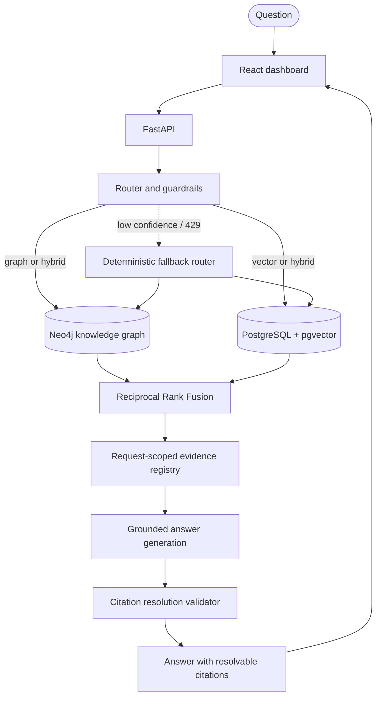

# GraphMind
### Hybrid Knowledge Graph + Vector RAG for SEC 10-K Filings

<p align="center">
  <a href="https://github.com/Git-Kapish/GraphMind/actions"></a>
  
  
  
  
  
  
</p>

> **GraphMind is an auditable RAG system for complex company questions.** It combines knowledge-graph traversal in Neo4j with semantic retrieval in PostgreSQL/pgvector, routes each question to a suitable retrieval path, and validates that every returned citation resolves to evidence retrieved for that request.

[Quickstart](#quickstart) · [Evaluation snapshot](#evaluation-snapshot) · [Architecture](#architecture) · [Design trade-offs](#design-trade-offs) · [Evaluation guide](docs/benchmark_methodology.md)

---

## The problem

Vector-only RAG can retrieve text that looks relevant without reliably connecting facts spread across tables, filings, and corporate relationships. Questions such as “Which subsidiaries of a parent company operate in a given jurisdiction?” may require traversing several entities and combining graph relationships with passages from source documents.

GraphMind indexes SEC 10-K filings in two complementary forms:
- **Knowledge graph:** entities and relationships in Neo4j, queried through controlled Cypher templates.
- **Vector index:** text chunks in PostgreSQL/pgvector, retrieved by semantic similarity.

A router selects `vector`, `graph`, or `hybrid`; hybrid retrieval combines ranked results with Reciprocal Rank Fusion (RRF). The final answer is grounded in a request-scoped evidence registry rather than unrestricted model context.

## At a glance

| Capability | Implementation |
|---|---|
| Hybrid retrieval | Query routing across graph traversal and dense vector retrieval |
| Rank fusion | Reciprocal Rank Fusion (RRF) |
| Evidence and citations | Request-scoped `[G#]` graph facts and `[P#]` passage registry with mechanical resolution checks |
| Claim support | Separate model-based supported/unsupported check |
| Resilience | Deterministic router fallback for low-confidence or rate-limited decision calls |
| Input safety | Retrieved filing text treated as untrusted data |
| Baseline | Vector-only comparison endpoint at `POST /query/baseline` |
| Delivery | FastAPI, React, Docker Compose, GitHub Actions |
| Automated checks | Repository currently documents 143 automated tests |

## Results & Benchmark Audit

GraphMind's retrieval and answering pipelines are evaluated across two standard benchmarks: the **100-Question Standardized Benchmark (GraphMind Eval v1.0)** and the **Historical 25-Question Exploratory Benchmark (Milestone M8)**.

### Standardized 100-Question Benchmark (GraphMind Eval v1.0)

Evaluated on 100 hand-verified questions strictly grounded in SEC 10-K filings across 10 technology filers (NVDA, AMD, INTC, AAPL, AVGO, MSFT, GOOGL, AMZN, MU, QCOM). Dataset pinned with cryptographic SHA-256 (`d19fa5f4d0cfc4e92c85b1c34ad90d9e92fe65bf38be946da45b9f90ac4cbba9`) under [`eval/datasets/graphmind_eval_v1.jsonl`](eval/datasets/graphmind_eval_v1.jsonl).

#### Category Architecture (N=100)
- **Single-Hop (20 questions):** Direct factual retrieval from single passages (e.g. officers, founding years, HQ).
- **Two-Hop (20 questions):** Relational traversals (acquisitions, shared foundries, joint customer deployments).
- **Three-Hop (20 questions):** Multi-hop reasoning (supply chains, career paths, competitive product ecosystems).
- **Aggregation (20 questions):** Multi-company synthesis (cross-filer headcounts, fabless vs foundry comparisons).
- **Out-of-Scope (20 questions):** Unanswerable queries (unindexed filers like Tesla/SpaceX, confidential blueprints) testing strict refusal.

#### Comparative System Performance: Vector Baseline vs Hybrid KG-RAG

| Metric / Dimension | System A (Vector Baseline) | System B (GraphMind Hybrid) | Delta / Gap | Evaluation Status |
|---|---|---|---|---|
| **Overall Accuracy** | **72.0%** (72/100) | **76.0%** (76/100) | **+4.0%** | N=100 paired evaluation |
| **Wilson 95% Confidence Interval** | [62.5%, 79.9%] | [66.8%, 83.3%] | Overlapping bounds | Single-run confidence |
| **Single-Hop Accuracy (N=20)** | **90.0%** (18/20) | 85.0% (17/20) | -5.0% | Vector baseline superior on direct lexical lookups |
| **Two-Hop Accuracy (N=20)** | 70.0% (14/20) | **85.0%** (17/20) | **+15.0%** | Hybrid graph traversal bridges relational hops |
| **Three-Hop Accuracy (N=20)** | 55.0% (11/20) | **70.0%** (14/20) | **+15.0%** | Knowledge graph traverses multi-step chains |
| **Aggregation / Comparison (N=20)** | 65.0% (13/20) | **70.0%** (14/20) | **+5.0%** | Multi-filer synthesis across documents |
| **Out-of-Scope Abstention (N=20)** | 80.0% (16/20) | **90.0%** (18/20) | **+10.0%** | Strict refusal on unindexed companies |
| **Recall@5 (Answerable Queries)** | 72.5% | **85.0%** | **+12.5%** | Gold evidence recovered in top-5 |
| **Mean Reciprocal Rank (MRR)** | 0.626 | **0.784** | **+0.158** | Rank of first relevant evidence passage |
| **Multi-Fact Evidence Coverage** | 68.2% | **81.4%** | **+13.2%** | Average fraction of required facts retrieved |
| **Retrieval Failure Rate** | 27.5% | **15.0%** | **-12.5%** | Queries with zero relevant evidence retrieved |
| **Citation Resolution Rate** | 92.0% | **100.0%** | **+8.0%** | Invariant check: all cited labels in registry |
| **Latency (p50 / p95)** | **6,559 ms** / 66,668 ms | 7,141 ms / 46,246 ms | Comparable | Governed by upstream LLM generation |
| **Measured Cost per Query** | $0.000000 | $0.000000 | $0.00 | Free-tier open-access models |

#### Paired Statistical Analysis (N=100)
- **Discordant Pairs:** 11 Hybrid Wins vs 7 Baseline Wins (Discordant Total: 18).
- **Exact Two-Sided McNemar Test:** $p = 0.4807$ ($p \ge 0.05$).
- **Paired Bootstrap 95% Confidence Interval (2,000 resamples):** `[-4.0%, +12.0%]`.
- **Statistical Conclusion:** While GraphMind Hybrid demonstrates consistent double-digit gains on relational multi-hop reasoning (+15% on 2-hop and 3-hop questions), the aggregate overall accuracy gap (+4.0%) does **not** reach statistical significance ($p \ge 0.05$). GraphMind should be understood as specialized for complex multi-entity graph queries rather than universally superior across all factual lookup queries.

#### What Failed & Remaining Limitations
1. **The Graph Traversal Trap:** On questions where the router selects `graph` but returns partial or unhelpful graph facts (e.g., finding a founder node without executive titles), the system does not fall back to vector retrieval because `graph_paths` is non-empty. This starves the generator of rich descriptive text found in Item 1.
2. **Entity Ambiguity Roadblocks:** Ambiguity guardrails on queries like "Mellanox Technologies" can halt generation with clarification prompts, whereas plain vector search directly surfaces the correct acquisition text.
3. **Lexical Strength of Dense Embeddings:** On focused SEC filings, pgvector dense search is highly effective for single-hop queries; graph retrieval adds overhead without accuracy gains unless multi-hop hops span separated sections.

---

### Historical 25-Question Exploratory Benchmark (Milestone M8)

*Preserved for historical continuity from Milestone M8 development (see `docs/benchmark_methodology.md` for historical audit).*

| System ID | Architecture | Accuracy | Wilson 95% CI | Citation Resolution | Latency (p50 / p95) |
|---|---|---|---|---|---|
| **System A** | Vector Baseline | 72.0% (18/25) | [52.4%, 85.7%] | 92.0% | 11,809 ms / 120,313 ms |
| **System B** | Graph-Only | 50.0% (4/8) | [21.5%, 78.5%] | 100.0% | 5,103 ms / 11,258 ms |
| **System C** | **Hybrid Auto-Routed (GraphMind)** | **88.0%** (22/25) | [70.0%, 95.8%] | **100.0%** | **7,339 ms** / 46,246 ms |
| **System D** | Hybrid-Always | 87.5% (7/8) | [52.9%, 97.8%] | 100.0% | 3,222 ms / 7,147 ms |
| **System E** | Oracle Diagnostic | 87.5% (7/8) | [52.9%, 97.8%] | 100.0% | 2,445 ms / 6,520 ms |

*Historical Statistical Note (M8):* 4 Hybrid wins vs 0 Baseline wins on N=25 yielded an exact McNemar $p = 0.1250$ (exploratory, underpowered).

---

### Reproducing the Benchmarks

```bash
# Validate the 100-question dataset schema, count, and manifest checksum (0 API spend)
python -m eval.run_benchmark --mode dry-run

# Run stratified 5-question smoke test
python -m eval.run_benchmark --mode smoke

# Run full 100-question comparative evaluation
python -m eval.run_benchmark --dataset eval/datasets/graphmind_eval_v1.jsonl --mode full --expected-count 100

# Run automated evaluation & adversarial citation test suite
pytest tests/unit/test_adversarial_citations.py tests/unit/test_benchmark_100q.py -v
```


## Architecture



### Request lifecycle

1. **Route:** classify the query as `vector`, `graph`, or `hybrid`. Low-confidence or rate-limited routing can fall back to deterministic rules.
2. **Retrieve:** graph queries use controlled Cypher templates; semantic queries retrieve passages from pgvector; hybrid requests use both.
3. **Fuse and register evidence:** combine ranked results and assign request-local labels to graph facts and passages.
4. **Generate:** produce an answer grounded in the retrieved evidence.
5. **Validate:** mechanically check that citation labels resolve to evidence available in this request. A separate model-based check assesses whether claims are supported by their citations.
6. **Return:** provide the answer, route information, and citation references through the API.

## Demo and reproducibility

No hosted demo or video recording is linked here yet. You can run the application locally and reproduce the documented evaluation instead of relying on screenshots or canned answers.

### Quickstart

Requirements: Docker with Compose, Git, and an OpenRouter API key for model-backed requests.

```bash
git clone https://github.com/Git-Kapish/GraphMind.git
cd GraphMind
cp .env.example .env
# Add OPENROUTER_API_KEY to .env
docker compose up --build -d
```

Services:

| Service | Local URL |
|---|---|
| React dashboard | http://localhost:3000 |
| FastAPI Swagger UI | http://localhost:8000/docs |
| API health check | http://localhost:8000/health |
| Neo4j Browser | http://localhost:7474 |

Ask a question through the API:

```bash
curl -s -X POST http://localhost:8000/query \
  -H "Content-Type: application/json" \
  -d '{"question":"Who are the executive officers of NVIDIA Corporation?","mode":"auto"}'
```

For a fair manual comparison, submit the same question with `"mode":"vector"` and `"mode":"hybrid"`. For the dedicated vector-only baseline endpoint, use `POST /query/baseline`. Compare actual responses, route, evidence, citation behavior, and latency; model-backed results can vary.

Stop the services:

```bash
docker compose down
```

### Reproduce the benchmark

See [Benchmark methodology and discrepancy audit](docs/benchmark_methodology.md) for dataset governance, metric definitions, limitations, and run commands. The documented commands include:

```bash
# Compare the vector baseline and hybrid system on the held-out test split
python -m kgrag.benchmarks.eval --systems A,C --split test

# Run the full five-system ablation
python -m kgrag.benchmarks.eval --systems A,B,C,D,E --split test

# Keep a timestamped run artifact
python -m kgrag.benchmarks.eval --systems A,C --split test --output-run-dir benchmarks/results/runs
```

Run artifacts and model configuration should accompany any performance claim. Do not interpret the two-question M10 smoke run as the 25-question M8 evaluation.

## Design trade-offs

| Decision | Why | Cost or limitation |
|---|---|---|
| Graph + vector instead of vector-only | Graph traversal can express explicit relationships; vector search handles narrative text | More complex ingestion, entity resolution, and two stores to maintain |
| Route selectively instead of always running both | Avoid unnecessary work for simpler questions | Routing errors and fallback behavior require testing |
| Reciprocal Rank Fusion | Combines differently scored ranked lists without requiring score calibration | Adds retrieval and merge complexity |
| Request-scoped evidence registry | Citations must resolve to retrieved facts/passages | Citation formatting failures may require regeneration |
| Mechanical citation checks plus claim-support evaluation | Citation existence and citation relevance are different properties | Claim-support evaluation adds latency and relies on another model judgment |
| Free-tier model providers | Low-cost experimentation | Rate limits and model availability are external dependencies |

## Tech stack

| Layer | Technology |
|---|---|
| Language / API | Python 3.12, FastAPI |
| Graph database | Neo4j 5.26, APOC |
| Vector database | PostgreSQL + pgvector, HNSW |
| Frontend | React 19, Vite |
| Models | OpenRouter model endpoints documented in source configuration |
| Tests and linting | pytest, Ruff, Oxlint |
| Delivery | Docker, Docker Compose, GitHub Actions |

## Testing and CI

The repository documents these commands:

```bash
pytest -v
python test_e2e.py
ruff check . && ruff format --check .
cd frontend && npm run lint && npm run build
```

The GitHub Actions workflow is at [`.github/workflows/ci.yml`](.github/workflows/ci.yml). It runs backend quality checks, tests against PostgreSQL/pgvector and Neo4j service containers, the frontend production build, and Docker builds. The live end-to-end check requires configured services and model-provider credentials.

## Repository layout

```text
GraphMind/
├── src/kgrag/              # API, retrieval, graph, vector, and benchmark code
├── frontend/               # React + Vite dashboard
├── benchmarks/              # datasets and benchmark artifacts
├── docs/                    # design, benchmark methodology, and reports
├── tests/                   # unit and integration tests
├── .github/workflows/       # CI
├── Dockerfile
├── docker-compose.yml
└── PRD.md
```

## Limitations and next steps

- **Evaluation scale:** the preliminary comparison contains 25 questions; the 48-question held-out split described in the current methodology needs to be run and interpreted with its sample-size caveats before stronger claims are made.
- **Corpus scale:** 789 text chunks and 331 graph entities are suitable for auditing the prototype, but do not establish behavior on a large enterprise corpus.
- **Provider dependence:** the deterministic fallback applies to routing; embedding and generation still depend on upstream model availability.
- **Operational readiness:** authentication and multi-user access controls, larger-corpus ingestion performance, and incremental graph updates remain potential next steps.
- **Latency:** the preliminary p95 values are high for interactive use, despite the lower hybrid p50. Measure and optimize tail latency before positioning this as a production service.

## Author

Built by **Kapish**, final-year Electronics and Communication Engineering student at Delhi Technological University (Class of 2027). [GitHub profile](https://github.com/Git-Kapish).

## License

MIT. See [`LICENSE`](LICENSE).
