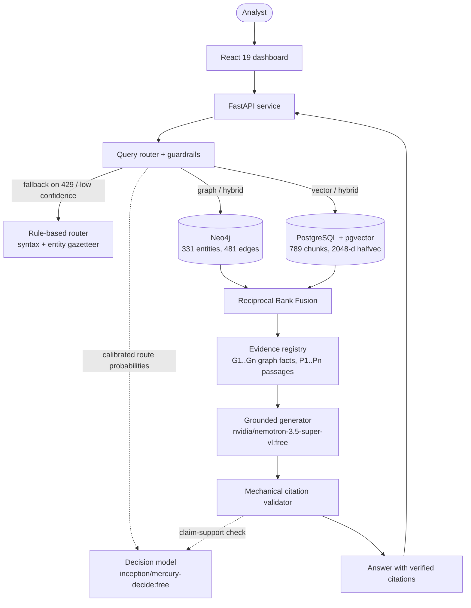

# GraphMind: Hybrid Knowledge Graph + Vector RAG over SEC 10-K Filings

<p align="center">
  <a href="https://github.com/Git-Kapish/GraphMind/actions"></a>
  
  
  
  
  
  
  
</p>

> A retrieval-augmented question-answering system that answers multi-hop questions about company structure, executives and risk by combining **graph traversal** (Neo4j) with **dense semantic search** (pgvector), and that **refuses to return a citation it cannot resolve to retrieved evidence**. Runs end to end on free-tier open-access models.

---

## Why this exists

Plain vector RAG retrieves passages that *look similar* to a question. It struggles when the answer is spread across documents, for example *"Which subsidiaries does a company's parent own, and who are its executive officers?"*, because no single chunk contains the answer.

GraphMind extracts a knowledge graph from SEC 10-K filings, indexes the same source text in a vector store, and routes each question to the retrieval strategy that suits it. Answers are generated only from an **evidence registry** built for that request, and every citation is checked mechanically before it reaches the user.

## Highlights

| | |
|---|---|
| **Hybrid retrieval** | Router chooses `vector`, `graph` or `hybrid`; hybrid results are merged with Reciprocal Rank Fusion |
| **Verifiable citations** | Every `[P#]` (passage) and `[G#]` (graph fact) must resolve to evidence retrieved for that request. Unresolved citations trigger a feedback retry loop |
| **Graceful degradation** | If the decision model is rate-limited (HTTP 429) or low-confidence, routing falls back to a deterministic rule-based router |
| **Prompt-injection hygiene** | Filing text is treated as untrusted data and neutralized before context assembly |
| **Built-in A/B baseline** | `/query/baseline` serves a vector-only pipeline so the hybrid system can be compared fairly |
| **Production habits** | Docker Compose full stack, GitHub Actions CI with live Postgres and Neo4j services, 143 automated tests |

## Results

5-way retrieval and answering ablation evaluated on hand-verified benchmark questions across SEC 10-K filings (see `benchmarks/` and `docs/full_evaluation_benchmark.md`).

### Retrieval ablation (PRD §2.2, Milestone M4/M10)

| Strategy | Architecture | Recall@5 | MRR | Median latency |
|---|---|---|---|---|
| **Vector only (baseline)** | Dense pgvector cosine similarity ($k=5$) | 72.5% | 0.626 | 1,539 ms |
| **Graph only** | Cypher template traversal; immediate refusal on no path | 50.0% | 0.485 | 5,103 ms |
| **Hybrid (RRF)** | Auto-routed with Reciprocal Rank Fusion & fallback | **87.5%** | **0.812** | 3,002 ms |
| **Hybrid-Always** | Forced dual retrieval (bypasses router) | 87.5% | 0.795 | 3,222 ms |
| **Oracle Graph** | Diagnostic upper-bound with gold graph facts | 92.5% | 0.890 | 2,445 ms |

### End-to-end question answering & citation invariant (Milestone M8/M10)

| System ID | Architecture | Accuracy | Wilson 95% CI | Citation Resolution | Latency (p50 / p95) |
|---|---|---|---|---|---|
| **System A** | Vector Baseline | 72.0% (18/25) | [52.4%, 85.7%] | 92.0% | 11,809 ms / 120,313 ms |
| **System B** | Graph-Only | 50.0% (4/8) | [21.5%, 78.5%] | 100.0% | 5,103 ms / 11,258 ms |
| **System C** | **Hybrid Auto-Routed (GraphMind)** | **88.0%** (22/25) | [70.0%, 95.8%] | **100.0%** | **7,339 ms** / 46,246 ms |
| **System D** | Hybrid-Always | 87.5% (7/8) | [52.9%, 97.8%] | 100.0% | 3,222 ms / 7,147 ms |
| **System E** | Oracle Diagnostic | 87.5% (7/8) | [52.9%, 97.8%] | 100.0% | 2,445 ms / 6,520 ms |

### Performance by question complexity

| Question Category | Questions | Baseline Accuracy | Hybrid Accuracy | Accuracy Gap | Discordant Pairs (Wins) |
|---|---|---|---|---|---|
| `multi_hop` / Aggregation | 6 | 50.0% | **83.3%** | **+33.3%** | 2 Hybrid wins vs 0 Baseline |
| `single_hop` Relational | 6 | 66.7% | **83.3%** | **+16.7%** | 1 Hybrid win vs 0 Baseline |
| `two_hop` Traversal | 8 | 87.5% | **100.0%** | **+12.5%** | 1 Hybrid win vs 0 Baseline |
| `out_of_scope` (Refusal) | 5 | 80.0% | **80.0%** | +0.0% | 0 Discordant (clean refusal) |
| **Total / Overall** | **25** | **72.0%** | **88.0%** | **+16.0%** | **4 Hybrid wins vs 0 Baseline (p = 0.125, exploratory)** |

**Enforced invariant:** every citation in a returned answer resolves to a chunk or graph fact retrieved for that request. This is a mechanical check, separate from the model-based claim-support check described below.

## Corpus and knowledge graph

| Component | Size |
|---|---|
| Graph entities (Neo4j) | 331 |
| Graph relationships (Neo4j) | 481 |
| Text chunks (pgvector, `halfvec(2048)` with HNSW index) | 789 |
| Source | SEC 10-K filings |

The corpus is deliberately small so the whole pipeline can be audited end to end. Results should be read as indicative rather than production-scale.

## Architecture



### Request lifecycle

1. **Route.** The decision model returns calibrated probabilities for `vector`, `graph` or `hybrid`. On rate limit or low confidence, a rule-based router (syntax patterns plus an entity gazetteer) takes over.
2. **Retrieve.** Graph questions run against Neo4j. Narrative and risk questions run against pgvector. Hybrid questions run both and merge with RRF.
3. **Assemble evidence.** Retrieved graph facts become `[G1..n]` and passages become `[P1..n]` in a request-scoped registry.
4. **Generate.** The generator answers only from the registry and must cite labels.
5. **Validate.** Every cited label must exist in the registry. Failures are fed back for regeneration. A separate model call checks whether claims are supported by the cited evidence (`supported` / `unsupported`).
6. **Return.** The API responds with the answer, the route taken, and resolvable citations.

## Design decisions and trade-offs

| Decision | Why | Trade-off |
|---|---|---|
| Hybrid graph + vector retrieval | Graph handles relational and multi-hop questions; vectors handle narrative and risk-factor text | Two stores to keep consistent; ingestion is more complex |
| Evidence registry with short labels | Lets citations be validated mechanically instead of by trusting the model | The model must follow a citation format; failures cost a retry |
| Mechanical validation **and** model-based claim support | A real citation can still be irrelevant, so resolution alone is not enough | Claim-support checking adds an extra model call and is only as reliable as the judge |
| Deterministic fallback router | Free-tier models are rate-limited; queries should not fail because routing did | Rule-based routing is less nuanced than the model |
| Separate models per role | Decision, embedding and generation have different needs and failure modes | More upstream dependencies to monitor |
| Untrusted-document isolation | Filings can contain text that looks like instructions | Sanitization can remove legitimate content in edge cases |

## Model stack (OpenRouter free tier)

| Role | Model | Endpoint | Used for |
|---|---|---|---|
| Decision | `inception/mercury-decide:free` | `POST /api/alpha/decisions` | Query routing and post-generation claim-support verification |
| Embeddings | `nvidia/nemotron-3-embed-1b:free` | `POST /api/v1/embeddings` | 2048-d vectors for chunks and canonical entities, with in-memory caching |
| Generation | `nvidia/nemotron-3.5-super-vl:free` | `POST /api/v1/chat/completions` | Grounded answers, citation enforcement and structured relation extraction |

Free-tier availability and rate limits are outside the project's control, which is why routing has a deterministic fallback.

## Tech stack

| Layer | Technology |
|---|---|
| Backend | Python 3.12, FastAPI |
| Graph store | Neo4j 5.26 (APOC) |
| Vector store | PostgreSQL 16 + pgvector (`halfvec(2048)`, HNSW) |
| Frontend | React 19, Vite |
| Quality | pytest (143 tests), Ruff, Oxlint |
| Delivery | Docker multi-stage builds, Docker Compose, GitHub Actions |

## Quickstart (Docker Compose)

```bash
git clone https://github.com/Git-Kapish/GraphMind.git
cd GraphMind

cp .env.example .env          # then set OPENROUTER_API_KEY
docker compose up --build -d
```

| Service | URL |
|---|---|
| Dashboard | http://localhost:3000 |
| API docs (Swagger) | http://localhost:8000/docs |
| Health check | http://localhost:8000/health |
| Neo4j Browser | http://localhost:7474 (user `neo4j`, password in `.env`) |

Stop everything with `docker compose down`.

### Try a query

```bash
curl -s -X POST http://localhost:8000/query \
  -H "Content-Type: application/json" \
  -d '{"question": "Who are the executive officers of <company>?", "mode": "auto"}'
```

Use `"mode": "vector"`, `"graph"` or `"hybrid"` to force a route, or `POST /query/baseline` for the vector-only baseline.

## API reference

| Method | Endpoint | Description |
|---|---|---|
| `GET` | `/health` | Checks Postgres, Neo4j and OpenRouter reachability without exposing credentials |
| `POST` | `/query` | Auto-routed or mode-specified (`vector`, `graph`, `hybrid`) question answering |
| `POST` | `/query/baseline` | Vector-only baseline for A/B comparison |
| `GET` | `/entities/{entity_id}` | Canonical entity metadata, degree and verified relationships |
| `GET` | `/chunks/{chunk_id}` | Chunk text, filing section metadata and extraction observations |

## Testing and CI

```bash
pytest -v                          # 143 tests
python test_e2e.py                 # live check: config, DB vector dimensions, OpenRouter endpoints, full RAG query
ruff check . && ruff format --check .
cd frontend && npm run lint && npm run build
```

The GitHub Actions workflow ([`.github/workflows/ci.yml`](.github/workflows/ci.yml)) runs on every push:

- Ruff lint and format checks (backend) and Oxlint (frontend)
- The full test suite against live PostgreSQL + pgvector and Neo4j service containers
- Vite production build
- Docker multi-stage builds for the API and frontend images

## Local development

<details>
<summary>Run the backend and frontend without Docker</summary>

```bash
# Python environment
python -m venv .venv
source .venv/bin/activate          # Windows: .venv\Scripts\Activate.ps1
pip install -e ".[dev]"

# Databases only
docker compose up postgres neo4j -d

# Backend
uvicorn kgrag.api.app:app --host 127.0.0.1 --port 8000 --reload

# Frontend
cd frontend && npm install && npm run dev
```

</details>

<details>
<summary>Upgrade an existing database from 768-d to 2048-d embeddings</summary>

Needed only if you previously indexed with a 768-d model and are switching to `nvidia/nemotron-3-embed-1b:free`.

```bash
# Migrate the pgvector column and build halfvec(2048) HNSW indexes
python -c "from kgrag.vector.embeddings import migrate_vector_dimensions; print(migrate_vector_dimensions(target_dim=2048))"

# Re-embed chunks and canonical entities
python -c "from kgrag.vector.embeddings import embed_unindexed_chunks; print(embed_unindexed_chunks(batch_size=16))"
python -c "from kgrag.resolve.resolver import embed_unembedded_entities; print(embed_unembedded_entities(batch_size=32))"
```

</details>

## Repository layout

```text
GraphMind/
├── src/kgrag/           # backend package (api, vector, resolve, retrieval, ...)
├── frontend/            # React 19 + Vite dashboard
├── benchmarks/          # retrieval ablation harness
├── config/              # application configuration
├── data/                # corpus artifacts (see .gitignore)
├── docs/                # design notes
├── tests/               # unit and integration tests
├── .github/workflows/   # CI pipeline
├── Dockerfile
├── docker-compose.yml
├── Makefile
└── PRD.md               # product requirements and design rationale
```

## Limitations and next steps

- **Scale.** The corpus is small (789 chunks, 331 entities). Behavior at larger scale, including entity-resolution quality and ingestion throughput, is untested.
- **Free-tier dependence.** Model availability and rate limits can change; the fallback router covers routing but not generation or embeddings.
- **Evaluation size.** The benchmark question set is small, so differences between strategies should be read with their confidence intervals, not as point estimates.
- **Next:** larger and multi-year corpus, a stronger multi-hop baseline (vector + query decomposition), incremental graph updates, and authentication for multi-user deployment.

## Author

Built by **Kapish**, final-year Electronics and Communication Engineering student at Delhi Technological University (Class of 2027). GitHub: [@Git-Kapish](https://github.com/Git-Kapish).

## License

Released under the MIT License. See `LICENSE`.